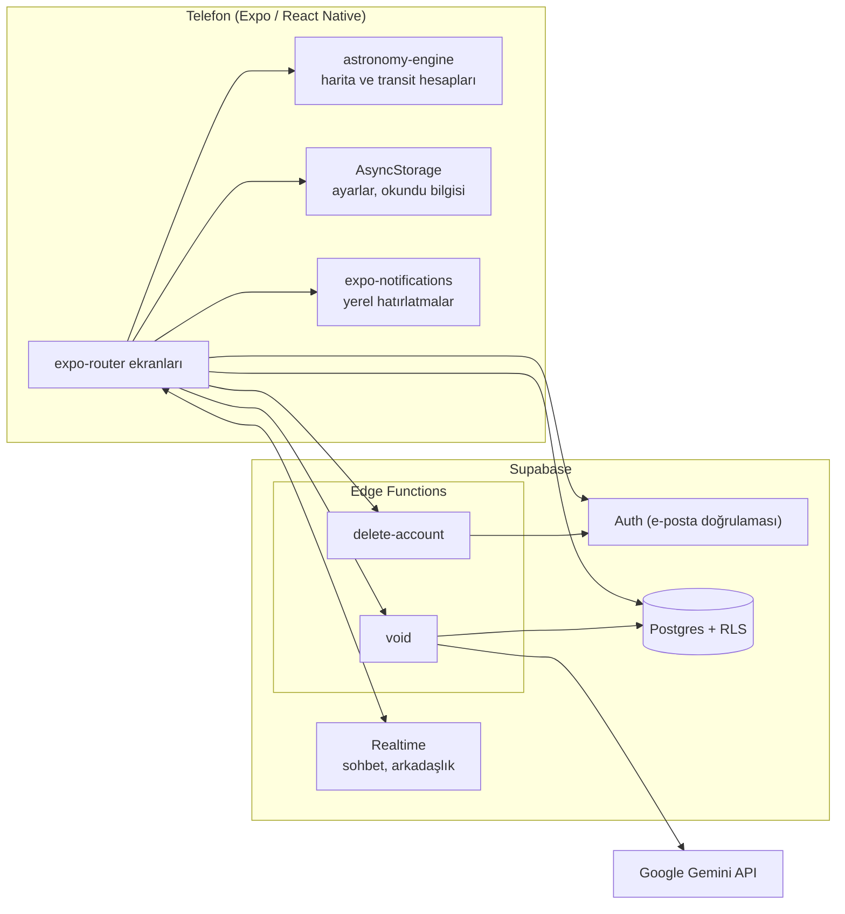

# LU — NA

Luna, Co–Star'dan ilham alan sosyal bir astroloji mobil uygulamasıdır. Ders ödevi kapsamında, popüler bir astroloji uygulamasını Claude Code ile yeniden geliştirip sorunlarını iyileştiriyoruz. Tasarım ve işlev referansı: [`docs/luna-prototip.html`](docs/luna-prototip.html).

## Co–Star'dan farkları

- **Türkçe ve İngilizce, renksiz arayüz.** Telefon dili İngilizceyse uygulama İngilizce açılır, değilse Türkçe; Ayarlar'dan değiştirilir. Yalnızca siyah, beyaz ve gri tonlar kullanılır.
- **Duygu şişesi ve tarot.** Her akşam duygu kaydı, haftalık şişe ve 78 kartlık desteden günün tarot kartı.
- **QR ile arkadaş ekleme.** Arkadaşlık, kodu yüz yüze okutarak kurulur.
- **Sunucuda sayılan Void kotası.** Yapay zekâ astrolog günde 5 soruyla sınırlıdır; sayaç istemciye bırakılmaz.
- **Sunucu gerektirmeyen bildirimler.** Hatırlatmalar telefonda yerel olarak zamanlanır.

## Özellikler

- Günlük yorum, Yap / Yapma, Derine in ve şans bölümleri
- Günde bir tarot kartı: 22 büyük + 56 küçük arkana (00:00'da yenilenir)
- Akşam duygu kaydı ve haftalık duygu şişesi, arşiv ve aylık özet
- Void: günde 5 soruluk yapay zekâ astrolog
- Arkadaşlar: QR ile ekleme, değiştirilebilir ilişki türü, gruplar, anlık sohbet ve uygulama içi bildirimler
- Doğum haritası, evler tablosu ve gezegen kartları
- Telefon bildirimleri: akşam hatırlatması ("Bugünü şişene ekle.") ve gece 00:00 kart bildirimi ("Yeni kartın hazır.")
- Ayarlar: dil, doğum bilgileri, ilişki durumu, yaşam evresi, ev sistemi, klasik gezegenler, bildirimler, gizlilik, destek (112)
- E-posta doğrulaması ve hesabı kalıcı olarak silme

## Mimari



- Doğum haritası ve günlük transitler cihazda hesaplanır, sunucuya gitmez.
- Veriler Supabase Postgres'te tutulur; her tabloda Row Level Security açıktır.
- Gemini anahtarı yalnızca `void` Edge Function'ında bulunur, uygulama paketine girmez.
- `delete-account` kullanıcıyı JWT ile doğrular, service role ile siler; tablolar `on delete cascade` ile temizlenir.

## Klasör yapısı

```
app.json, package.json, tsconfig.json
assets/            görseller, ikonlar
docs/              tasarım referansı (luna-prototip.html)
supabase/
  migrations/      SQL şeması (0001 … 0007)
  functions/
    void/            Gemini ile yapay zekâ astrolog
    delete-account/  hesabı silme
src/
  app/             expo-router ekranları
    (auth)/          giriş, kayıt, e-posta doğrulama
    (onboarding)/    ad, kullanıcı adı, doğum bilgileri, bildirim izni
    (tabs)/          BUGÜN, ARKADAŞLAR, VOID, GÜNLÜK, SEN
  components/      paylaşılan UI bileşenleri
  lib/             Supabase istemcisi, astroloji, günlük metinler, hatırlatmalar
  theme/           renkler, fontlar, ölçüler
```

`@/` takma adı `src/` klasörünü gösterir.

## Kurulum

```
npm install
```

1. **`.env` dosyası.** `.env.example` dosyasını `.env` olarak kopyala ve doldur:
   ```
   EXPO_PUBLIC_SUPABASE_URL=
   EXPO_PUBLIC_SUPABASE_ANON_KEY=
   ```
   Supabase panelinde Project Settings › API sayfasındaki URL ve `anon` anahtarı yazılır. `.env` asla commitlenmez.
2. **Migration sırası.** SQL Editor'da `supabase/migrations/` altındaki dosyaları numara sırasıyla çalıştır:
   `0001_profiles` › `0002_daily_tarot` › `0003_moods` › `0004_social` › `0005_realtime_social` › `0006_group_added_by` › `0007_void` › `0008_tarot_78`.
3. **E-posta doğrulaması.** Authentication › Providers › Email bölümünde "Confirm email" açık olmalı. Authentication › URL Configuration'da Site URL'i gerçek bir adrese ayarla; aksi halde doğrulama bağlantısı localhost'a düşer.
4. **Edge Function'lar ve gizli anahtarlar.** [Google AI Studio](https://aistudio.google.com/apikey)'dan bir Gemini anahtarı al, sonra:
   ```
   npx supabase login
   npx supabase link --project-ref <proje-ref>
   npx supabase secrets set GEMINI_API_KEY=<gemini-anahtarı>
   npx supabase functions deploy void
   npx supabase functions deploy delete-account
   ```
   `SUPABASE_URL`, `SUPABASE_ANON_KEY` ve `SUPABASE_SERVICE_ROLE_KEY` fonksiyonlara Supabase tarafından kendiliğinden verilir. İki fonksiyonu da JWT doğrulaması açık yayınla (`--no-verify-jwt` kullanma). Void modeli `supabase/functions/void/index.ts` içindeki `MODEL` sabitidir. Loglar için: `npx supabase functions logs void`.
5. **Çalıştır.**
   - `npm start`: geliştirme sunucusu, telefonda Expo Go ile aç
   - `npm run web`: tarayıcıda hızlı önizleme (bildirimler web'de çalışmaz)
   - `npm run typecheck`: tip kontrolü
   - `npm test`: birim testleri

## Güvenlik notları

- **RLS.** Tüm tablolarda Row Level Security açıktır; kullanıcı yalnızca kendi satırlarını ve üyesi olduğu arkadaşlık ve grup verilerini görür. Kullanıcı adı kontrolü gibi başkasının satırına bakması gereken işler `security definer` fonksiyonlarıyla, yalnızca gereken sonucu döndürerek yapılır.
- **QR kodları.** Kodlar süreli ve tek kullanımlıktır, `friend_codes` tablosuna istemci erişemez. Arkadaşlık satırı doğrudan eklenemez; yalnızca `add_friend_by_code` fonksiyonuyla kurulur ve kişi kendini ekleyemez.
- **Sunucuda kota.** Void'in günlük 5 soru sınırı Edge Function'da, Europe/Istanbul gününe göre sayılır. İstemci sayacı yalnızca gösterim içindir; sınır atlatılamaz. Cevap alınamazsa hak düşmez.
- **Gizli anahtarlar.** Gemini anahtarı ve service role anahtarı yalnızca Edge Function ortamında durur. İstemciye yalnızca `EXPO_PUBLIC_` önekli URL ve `anon` anahtar verilir.
- **Hesap silme.** `delete-account` yalnızca isteği yapan kullanıcının kendi hesabını siler; kimlik JWT'den alınır, istekten gelen hiçbir kimlik kullanılmaz.
- **Gizlilik.** Void'e yazılanlar cevap üretmek için Google Gemini'ye gönderilir. Void, seçili dilde cevap verir.
- **Bildirim izni.** Reddedilirse uygulama normal çalışır; Ayarlar'da izin durumu görünür.

## Ekip ve çalışma düzeni

- `main` dalına doğrudan push yok. Her özellik ayrı bir branch ve pull request ile gelir (örn. `feat/bugun-yorum`, `fix/tarih-formati`).
- Bir PR tek bir özelliği kapsar; küçük ve incelenebilir tutulur.
- Commit mesajları Türkçe ve kısadır.
- Commit öncesi `npm run typecheck` ve `npm test` temiz olmalı.
- Geliştirme Claude Code ile yapılır; proje kuralları [`CLAUDE.md`](CLAUDE.md) dosyasındadır.
